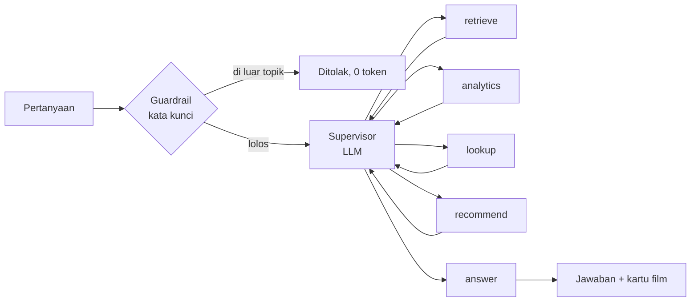

# IMDb Movie Assistant

Chatbot film berbasis **multi-agent (LangGraph)** dan **RAG** atas 1000 film IMDb Top.
Pengguna bertanya dalam bahasa natural, memberi rating, dan mendapat rekomendasi.

| Bagian | Teknologi |
|---|---|
| Otak agent | LangGraph (supervisor + 4 agent + answer) |
| LLM, embedding, reranker | OpenRouter |
| Pencarian makna (RAG) | Qdrant Cloud, payload hanya `sqlite_id` |
| Data film | SQLite `data/database.db` (read-only) |
| Prompt dan monitoring | Langfuse |
| Tampilan | Streamlit |

## Cara kerja



Supervisor memilih **satu langkah** per giliran, lalu kontrol kembali padanya sampai ia memilih `answer`.
Satu agent hanya boleh dipakai sekali per pertanyaan, jadi alurnya tidak berputar.

### Agent dan tool

| Agent | Dipakai untuk | Tool / sumber | Contoh pertanyaan |
|---|---|---|---|
| `retrieve` | Cari film dari **deskripsi** | `search_movies`: embedding → Qdrant → SQLite → reranker | "film perang dunia kedua yang menyedihkan" |
| `analytics` | **Angka dan statistik** | `movie_stats`: LLM menulis SQL → SQLite | "5 sutradara dengan film terbanyak" |
| `lookup` | Film dari **judul** (tahan salah ketik) | `find_movies_by_title`: SQLite | "film discable me?" |
| `recommend` | Rekomendasi dari **rating user** | PCA 2D, tanpa LLM (`pca.py`) | "rekomendasikan berdasarkan rating saya" |
| `answer` | Menyusun jawaban akhir | LLM, hanya dari konteks yang terkumpul | (selalu terakhir) |

### Pengaman

- **Guardrail 2 lapis**: (1) daftar kata kunci di kode, 0 token; (2) supervisor LLM menandai `blocked` untuk yang lolos.
- **Anti-halusinasi**: `lookup` melaporkan judul yang *sudah dicek dan tidak ada*; kalau tidak ada tool yang jalan,
  `answer` dilarang mengklaim film ada atau tidak ada di database.
- **SQL aman**: database dibuka read-only, dan hanya `SELECT` yang dijalankan.
- **Batas usia**: user wajib mengisi umur; film disaring di kode (lihat bagian di bawah).
- **Batas biaya per sesi** (`LIMIT_USD`): lewat batas, chat dimatikan sampai halaman di-refresh.

## Jalankan

```bash
poetry install
cp .env.example .env            # Windows: copy .env.example .env, lalu isi kuncinya
poetry run streamlit run app.py
poetry run python tests/test_basics.py   # 18 tes offline (tanpa LLM / internet)
```

Prompt disimpan di **Langfuse**, bukan di kode. Salinan teksnya ada di [prompts_reference/](prompts_reference/);
untuk akun Langfuse baru, buat 3 prompt dengan nama dan label `production` yang sama, lalu isi dengan teks itu.

## Batas usia

User **wajib mengisi umur** di sidebar sebelum bisa memakai aplikasi. Umur hanya dari kotak itu (mengetik
"umur saya 30" di chat tidak berpengaruh). Sertifikat film dipetakan ke umur minimal, dan film hanya tampil
kalau `umur >= umur minimal`. Semua aturannya ada di satu file: [age_rules.py](src/imdb_anwar/age_rules.py).

| Umur minimal | Sertifikat | Film |
|---|---|---|
| 0+ | U, G, Approved, Passed | 291 |
| 13+ | PG, GP, TV-PG, UA, U/A, PG-13, TV-14 | 262 |
| 17+ | R, TV-MA, 16 | 148 |
| 18+ | A | 197 |
| 17+ | tidak diketahui (kosong / unrated) | 102 |

Prinsipnya: kalau ragu, pilih batas yang lebih ketat. Hasil: umur < 13 melihat 291 film, 13-16 melihat 553,
17 melihat 803, dan ≥ 18 melihat 1000.

Penyaringan dilakukan **di kode, bukan lewat prompt**, di setiap jalur: kartu acak, rekomendasi PCA, grafik PCA,
pencarian Qdrant, dan SQL buatan LLM (yang hanya "melihat" film yang boleh lewat view sementara).
Film dibatasi yang ditanyakan langsung dijawab jujur: "filmnya ada, tapi tidak sesuai batas usia" (tanpa detail).
Mengganti umur mengosongkan chat dan menghapus rating film yang kini dibatasi.

> Umur diisi sendiri dan **tidak diverifikasi**: ini filter kenyamanan, bukan pengamanan.

## Skenario demo

| Ketik | Yang terjadi |
|---|---|
| `film discable me ?` | `lookup` mengenali salah ketik → **Despicable Me** |
| `rekomendasikan film perang dunia kedua yang menyedihkan` | `retrieve` → RAG lewat Qdrant |
| `5 sutradara dengan film terbanyak, sebutkan juga filmnya` | `analytics` → SQL, hasil tampil di chat |
| beri rating 2-3 film, lalu `rekomendasikan berdasarkan rating saya` | `recommend` → tetangga terdekat di peta PCA |
| `apakah film Minions ada di database?` | Jujur "tidak ada", lalu menawarkan film mirip |
| `tolong buatkan kode python hello world` | Guardrail menolak tanpa memanggil LLM |
| umur `10`, lalu `apakah film Pulp Fiction ada?` | "Ada, tapi tidak sesuai batas usia"; ganti umur `30` → filmnya tampil |

Panel kiri (console log) menampilkan siapa yang dipanggil, token, dan biaya tiap langkah.
Batas biaya bawaan sangat kecil (`0.001` USD) supaya mudah didemokan; naikkan lewat `LIMIT_USD` di `.env`.

## Peta file

```
app.py                       Halaman Streamlit: state sesi + susunan 5 panel
src/imdb_anwar/
  workflow.py                Graph LangGraph: supervisor, 4 agent, answer, run()
  tools.py                   3 tool: search_movies, find_movies_by_title, movie_stats
  vectorstore.py             RAG: embed -> Qdrant -> rerank
  titles.py                  Pencocokan judul (abaikan tanda baca, aksen, salah ketik)
  pca.py                     Titik selera dari rating dan tetangga terdekat
  database.py                Query SQLite + format film untuk LLM dan UI
  guardrail.py               Daftar kata kunci terlarang
  age_rules.py               Aturan batas usia: sertifikat -> umur minimal
  tracing.py                 Panggil LLM + catat log, token, biaya, Langfuse
  prompts.py                 Ambil prompt dari Langfuse
  config.py                  .env dan client (LLM, Qdrant, Langfuse)
  ui.py                      Komponen gambar: poster, kartu, grafik PCA
tests/test_basics.py         Tes offline
prompts_reference/           Teks 3 prompt Langfuse (dokumentasi)
docs/CATATAN.md              Catatan detail: fitur UI, hasil ukur PCA, catatan model
data/                        database.db, CSV asli, ingest.ipynb (embedding -> Qdrant)
pca/pca_model.ipynb          Notebook pembuatan kolom PC1/PC2
assets/                      Gambar banner (jailbreak, batas biaya)
graph_output/workflow.png    Diagram graph (dibuat oleh view_graph.py)
```
