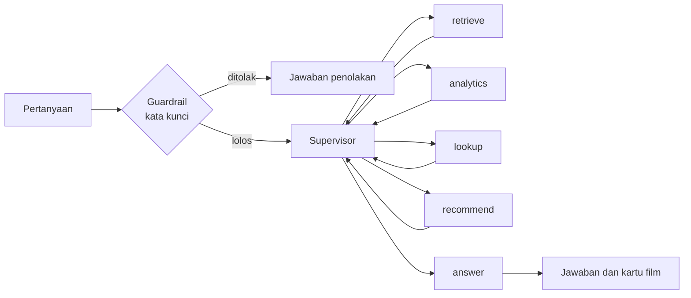

# IMDb Movie Assistant

Chatbot film berbasis multi-agent (LangGraph) dan Retrieval-Augmented Generation (RAG) dengan data 1000 film IMDb Top.
Pengguna dapat mencari film dari deskripsi atau judul, menanyakan statistik koleksi, dan mendapat rekomendasi dari
rating yang mereka berikan. Antarmuka dibuat dengan Streamlit.

## Fitur

- Pencarian film dari deskripsi dengan pencarian semantik (Qdrant) dan reranker.
- Pencarian dari judul, termasuk judul yang salah ketik (contoh: "discable me" menemukan *Despicable Me*).
- Pertanyaan statistik dijawab lewat query SQL yang dibuat LLM dan dijalankan pada SQLite.
- Rekomendasi dari rating pengguna menggunakan peta PCA 2 dimensi.
- Filter batas usia berdasarkan sertifikat film.
- Guardrail terhadap permintaan di luar topik film dan percobaan mengubah instruksi.
- Pemantauan token dan biaya per sesi, serta batas biaya per sesi.
- Pelacakan di Langfuse untuk setiap giliran chat: supervisor, agent, tool, embedding, Qdrant, reranker, dan LLM,
  lengkap dengan token, biaya, dan versi prompt yang dipakai.

## Arsitektur



Diagram graph hasil render LangGraph tersedia di [graph_output/workflow.png](graph_output/workflow.png)
(dibuat ulang dengan `python view_graph.py`, memerlukan koneksi internet).

### Alur satu pertanyaan

1. `app.py` memanggil `workflow.run()` dengan pertanyaan, riwayat chat, rating, dan umur pengguna.
2. `guardrail.check()` mencocokkan pertanyaan dengan daftar kata kunci. Jika cocok, jawaban penolakan dikirim
   tanpa memanggil LLM.
3. `supervisor` (LLM dengan output terstruktur `Decision`) memilih satu langkah berikutnya: `retrieve`, `analytics`,
   `lookup`, `recommend`, atau `answer`. Supervisor juga dapat menandai permintaan sebagai `blocked`.
4. Agent yang dipilih memanggil tool-nya dan menambahkan hasilnya ke `context`. Kontrol kembali ke supervisor.
   Setiap agent hanya dapat dipilih satu kali per pertanyaan.
5. Setelah supervisor memilih `answer`, LLM menyusun jawaban akhir dari `context` dan riwayat chat.
6. Film yang ditemukan agent ikut dikirim ke UI sebagai kartu yang dapat diberi rating.

### Agent dan tool

| Agent | Fungsi | Tool atau sumber data |
|---|---|---|
| `retrieve` | Mencari film dari deskripsi | `search_movies`: embedding, Qdrant, SQLite, reranker |
| `lookup` | Mengambil film dari judul | `find_movies_by_title`: pencocokan judul di SQLite |
| `analytics` | Menjawab pertanyaan angka | `movie_stats`: LLM menulis SQL, dijalankan pada SQLite |
| `recommend` | Rekomendasi dari rating pengguna | Fungsi di `pca.py` (tanpa LLM) |
| `answer` | Menyusun jawaban akhir | LLM, hanya dari `context` |

Perincian setiap tool:

- **`search_movies`**: teks pertanyaan diubah menjadi embedding, 30 kandidat dicari di Qdrant (payload hanya berisi
  `sqlite_id`), data film diambil dari SQLite dan disaring umur. Maksimal 15 teratas dikirim ke reranker, yang
  memilih 5 film. Jika reranker gagal, urutan dari Qdrant dipakai dan sumber urutan dicatat di log.
- **`find_movies_by_title`**: mengembalikan tiga daftar: film yang cocok, film yang ada tetapi dibatasi usia
  (hanya judul dan umur minimal), dan judul yang tidak ditemukan. Pencocokan dilakukan bertahap: cocok persis,
  potongan judul, lalu kemiripan teks (`difflib`, ambang 0,8) untuk salah ketik. Tanda baca, aksen, dan tahun
  pada judul diabaikan.
- **`movie_stats`**: LLM menulis satu query `SELECT` dari pertanyaan dan skema tabel. Query diperiksa
  (`_is_safe_select`) lalu dijalankan pada koneksi read-only (maksimal 50 baris).
- **Rekomendasi PCA**: titik selera dihitung dari 7 rating terbaru. Film dengan rating 6 ke atas menarik titik
  selera (dibobot nilai rating), sedangkan rating 5 ke bawah mendorongnya menjauh. Film terdekat dari titik itu
  (jarak euclidean pada PC1 dan PC2) menjadi rekomendasi.

## Data

| Komponen | Isi |
|---|---|
| `data/imdb_top_1000.csv` | Data mentah 1000 film |
| `data/database.db` | SQLite, tabel `imdb_movies` (1000 baris, termasuk kolom `PC1` dan `PC2`) |
| Qdrant (koleksi `imdb_movies`) | Embedding tiap film (1536 dimensi, cosine), payload `{"sqlite_id": ...}` |
| `data/ingest.ipynb` | Membersihkan data, mengisi SQLite, membuat embedding, dan mengisi Qdrant |
| `pca/pca_model.ipynb` | PCA 2 komponen, hasilnya disimpan sebagai kolom `PC1` dan `PC2` |

Data teks film hanya disimpan di SQLite. Qdrant dipakai untuk mencari id film yang maknanya paling dekat.
Kedua notebook adalah catatan proses pembuatan data. Aplikasi tidak menjalankannya, tetapi koleksi Qdrant harus
sudah terisi agar `retrieve` dan fallback `lookup` berfungsi.

## Batas usia

Pengguna harus mengisi umur di sidebar sebelum aplikasi menampilkan film. Umur hanya dibaca dari kotak input
tersebut, bukan dari isi chat. Sertifikat film dipetakan ke umur minimal, dan film ditampilkan jika
umur pengguna sama dengan atau lebih besar dari umur minimal. Aturan ada di satu modul:
[src/imdb_anwar/age_rules.py](src/imdb_anwar/age_rules.py).

| Umur minimal | Sertifikat | Jumlah film |
|---|---|---|
| 0 | U, G, Approved, Passed | 291 |
| 13 | PG, GP, TV-PG, UA, U/A, PG-13, TV-14 | 262 |
| 17 | R, TV-MA, 16 | 148 |
| 18 | A | 197 |
| 17 | Tidak diketahui (kosong atau unrated) | 102 |

Film yang dapat dilihat per umur: di bawah 13 tahun 291 film, 13 sampai 16 tahun 553 film, 17 tahun 803 film,
dan 18 tahun ke atas 1000 film. Untuk sertifikat yang meragukan dipilih batas yang lebih tinggi.

Penyaringan dilakukan di kode pada semua jalur: kartu acak, rekomendasi PCA, grafik PCA, hasil Qdrant, dan query SQL
dari LLM. Untuk SQL, `database.run_select` membuat view sementara bernama `imdb_movies` yang sudah tersaring,
sehingga query hanya dapat melihat film yang diizinkan. Query yang menyebut schema `main` atau `temp` ditolak agar
view tidak dapat dilewati.

Jika pengguna menanyakan film yang ada tetapi dibatasi usia, agent menerima informasi bahwa film tersebut ada dan
dibatasi (tanpa sinopsis). Saat umur diganti, riwayat chat dikosongkan dan rating film yang kini dibatasi dihapus.

Umur diisi sendiri dan tidak diverifikasi.

## Pengaman

| Risiko | Penanganan |
|---|---|
| Permintaan di luar topik atau mengubah instruksi | Dua lapis: kata kunci di `guardrail.py` (tanpa LLM) dan penandaan `blocked` oleh supervisor |
| SQL berbahaya dari LLM | Prompt hanya mengizinkan `SELECT`, `_is_safe_select` menolak kata kunci perubah data, dan database dibuka read-only |
| Klaim film "tidak ada" tanpa pengecekan | `lookup` melaporkan judul yang tidak ditemukan; bila tidak ada tool yang berjalan, `answer` diberi catatan agar tidak menyatakan film ada atau tidak ada |
| Biaya tidak terkendali | `LIMIT_USD` per sesi (bawaan 0,001 USD) yang menjumlahkan biaya LLM, embedding, dan reranker. Setelah terlampaui, input chat dinonaktifkan sampai halaman dimuat ulang |
| Provider LLM gagal atau lambat | Satu kali pengulangan otomatis; jika tetap gagal, pesan kesalahan ditampilkan dan aplikasi tetap berjalan |

## Pelacakan di Langfuse

Setiap pertanyaan menjadi satu trace bernama `imdb-agent` (dikelompokkan per sesi). Isinya berupa pohon observasi:

```
chat-turn                          chain        input: pertanyaan, umur; output: jawaban, agent yang dipakai
|- supervisor                      generation   LLM, tertaut ke prompt imdb-supervisor
|- retrieve-agent                  agent
|   `- search_movies               tool
|       |- embedding               embedding    biaya embedding
|       |- qdrant-search           retriever    id film dan skor kemiripan
|       `- rerank                  span         urutan hasil, sumber urutan
|- analytics-agent                 agent
|   `- movie_stats                 tool
|       |- sql                     generation   LLM penulis SQL, tertaut ke prompt imdb-sql-agent
|       `- sqlite-query            span         SQL yang dijalankan, jumlah baris
|- lookup-agent                    agent
|   `- find_movies_by_title        tool         film ditemukan, dibatasi usia, tidak ditemukan
|- recommend-agent                 agent
|- supervisor                      generation   (dipanggil lagi setelah tiap agent)
`- answer                          generation   LLM, tertaut ke prompt imdb-answer-agent
```

- Observasi `generation` mencatat model, token, biaya, dan versi prompt, sehingga kolom "Number of Observations"
  pada halaman Prompts di Langfuse terisi.
- Biaya embedding, reranker, dan LLM penulis SQL ikut dijumlahkan ke total sesi. Angka biaya di console log dan
  batas `LIMIT_USD` mencakup semuanya.
- Biaya reranker dicatat di metadata observasi `rerank` dan di total sesi, tetapi tidak tampil sebagai kolom biaya
  di Langfuse karena observasinya bertipe `span`.
- Pertanyaan yang ditolak guardrail kata kunci hanya menghasilkan observasi `guardrail` di bawah `chat-turn`.

## Antarmuka

- **Sidebar**: input umur, jumlah film yang tersedia untuk umur tersebut, dan tabel aturan.
- **Kiri**: console log berisi token, biaya, dan urutan pemanggilan supervisor, agent, tool, dan LLM.
- **Tengah**: chat. Film pada jawaban menampilkan poster dan input rating. Panel "bukti" menampilkan konteks
  yang dipakai agent.
- **Kanan**: kartu rekomendasi (acak, hasil PCA, atau hasil chat) dan kartu acak untuk eksplorasi. Setiap kartu
  memiliki slider rating 1 sampai 10.
- **Bawah**: sebaran PCA seluruh film yang diizinkan, beserta titik selera dan jangkauan rekomendasi, serta daftar
  film yang sudah diberi rating.

## Struktur repositori

```
app.py                         Halaman Streamlit: state sesi, input umur, susunan panel
view_graph.py                  Membuat graph_output/workflow.png
src/imdb_anwar/
  workflow.py                  State, supervisor, agent, graph LangGraph, run()
  tools.py                     Tool: search_movies, find_movies_by_title, movie_stats
  vectorstore.py               Embedding, pencarian Qdrant, reranker
  titles.py                    Pencocokan judul
  pca.py                       Titik selera dan film terdekat pada peta PCA
  database.py                  Akses SQLite dan pemformatan film
  age_rules.py                 Pemetaan sertifikat ke umur minimal
  guardrail.py                 Daftar kata kunci terlarang
  tracing.py                   Pemanggilan LLM, log, token, biaya, Langfuse
  prompts.py                   Pengambilan prompt dari Langfuse
  config.py                    Variabel environment dan client layanan
  ui.py                        Komponen tampilan: poster, kartu, grafik PCA
tests/test_basics.py           Tes offline
data/                          CSV, database.db, ingest.ipynb
pca/pca_model.ipynb            Pembuatan kolom PC1 dan PC2
assets/                        Gambar banner (jailbreak dan batas biaya)
graph_output/workflow.png      Diagram graph
```

## Menjalankan

Prasyarat: Python 3.13 atau lebih baru, [Poetry](https://python-poetry.org/), serta akun OpenRouter, Qdrant Cloud,
dan Langfuse.

```bash
poetry install
poetry run streamlit run app.py
```

Streamlit yang dipakai harus versi 1.66.1 atau lebih baru (sesuai `pyproject.toml`).

### Variabel environment

Buat file `.env` di root proyek.

| Variabel | Wajib | Bawaan | Keterangan |
|---|---|---|---|
| `OPENROUTER_API_KEY` | ya | | Kunci API OpenRouter (LLM, embedding, reranker) |
| `QDRANT_URL` | ya | | URL klaster Qdrant Cloud |
| `QDRANT_API_KEY` | ya | | Kunci API Qdrant |
| `LANGFUSE_PUBLIC_KEY` | ya | | Kunci publik Langfuse |
| `LANGFUSE_SECRET_KEY` | ya | | Kunci rahasia Langfuse |
| `LANGFUSE_HOST` | ya | | Alamat Langfuse |
| `LLM_MODEL` | tidak | `google/gemini-2.5-flash` | Model chat |
| `EMBEDDING_MODEL` | tidak | `openai/text-embedding-3-small` | Model embedding (1536 dimensi) |
| `RERANK_MODEL` | tidak | `qwen/qwen3-reranker-8b` | Model reranker. Nama lama `Rerank_MODEL` masih dikenali |
| `QDRANT_COLLECTION` | tidak | `imdb_movies` | Nama koleksi Qdrant |
| `LIMIT_USD` | tidak | `0.001` | Batas biaya per sesi (USD) |
| `LANGFUSE_PROMPT_LABEL` | tidak | `production` | Label prompt yang dipakai |
| `LANGFUSE_PROMPT_SUPERVISOR` | tidak | `imdb-supervisor` | Nama prompt supervisor |
| `LANGFUSE_PROMPT_SQL` | tidak | `imdb-sql-agent` | Nama prompt pembuat SQL |
| `LANGFUSE_PROMPT_ANSWER` | tidak | `imdb-answer-agent` | Nama prompt jawaban akhir |

### Prompt di Langfuse

Prompt tidak disimpan di repositori. Aplikasi mengambilnya dari Langfuse dengan label `production` dan mengisi
variabel berformat `{{nama}}`. Tiga prompt yang harus tersedia:

| Nama | Variabel | Fungsi |
|---|---|---|
| `imdb-supervisor` | `{{question}}`, `{{history}}`, `{{context}}` | Memilih route berikutnya |
| `imdb-sql-agent` | `{{question}}`, `{{schema}}` | Membuat satu query `SELECT` |
| `imdb-answer-agent` | `{{question}}`, `{{context}}` | Menyusun jawaban akhir dari konteks |

Jika salah satu prompt tidak ditemukan, aplikasi menampilkan pesan yang menyebut nama prompt tersebut.

### Contoh pertanyaan

| Pertanyaan | Jalur |
|---|---|
| `film discable me ?` | `lookup` (pencocokan salah ketik) |
| `rekomendasikan film perang dunia kedua yang menyedihkan` | `retrieve` |
| `5 sutradara dengan film terbanyak, sebutkan juga filmnya` | `analytics` |
| `rekomendasikan film berdasarkan rating saya` (setelah memberi rating) | `recommend` |
| `apakah film Minions ada di database?` | `lookup`, lalu pencarian semantik sebagai alternatif |
| `tolong buatkan kode python hello world` | Guardrail |

## Pengujian

```bash
python tests/test_basics.py
```

Terdapat 19 tes yang berjalan offline (hanya memakai SQLite lokal, tanpa LLM maupun jaringan). Cakupannya:
pencocokan judul, guardrail, validasi SQL, filter batas usia, pencatatan biaya, dan perhitungan titik selera PCA.
Alur end-to-end dengan LLM belum dicakup tes otomatis.

## Keterbatasan

- Umur diisi sendiri oleh pengguna dan tidak diverifikasi. Filter ini tidak dimaksudkan sebagai pengamanan.
- PCA 2 dimensi hanya mempertahankan sebagian kecil informasi embedding. Rekomendasinya cukup untuk kemiripan
  tema, tetapi kurang akurat untuk memprediksi selera.
- Cakupan data terbatas pada 1000 film. Sertifikat kosong pada 102 film diperlakukan sebagai 17 tahun ke atas.
- Statistik dari `analytics` dihitung hanya atas film yang diizinkan untuk umur pengguna, sehingga angkanya dapat
  berbeda dari seluruh koleksi.
- Kualitas jawaban bergantung pada model LLM. Pertanyaan yang ambigu dapat ditafsirkan keliru oleh model.
- Aplikasi tidak dapat dijalankan tanpa tiga prompt di Langfuse dan koleksi Qdrant yang terisi.
- Beberapa sel pada notebook membaca file perantara yang tidak disertakan di repositori, sehingga notebook tidak
  dapat dijalankan ulang dari awal tanpa penyesuaian path.
